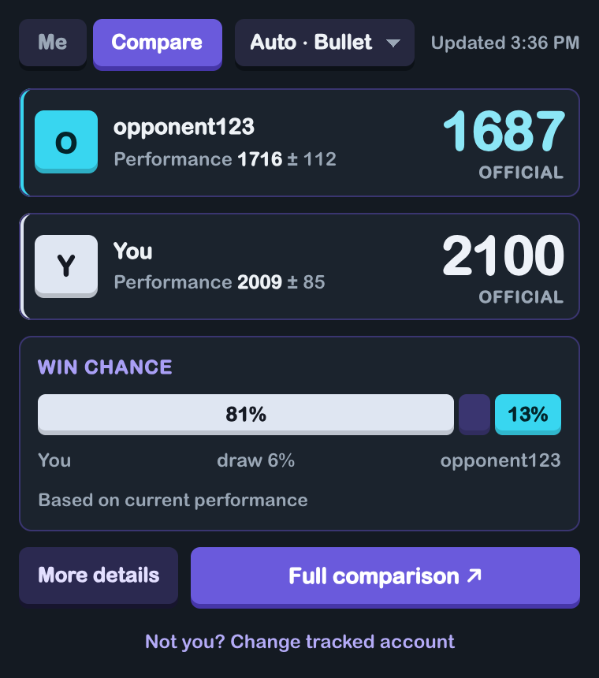
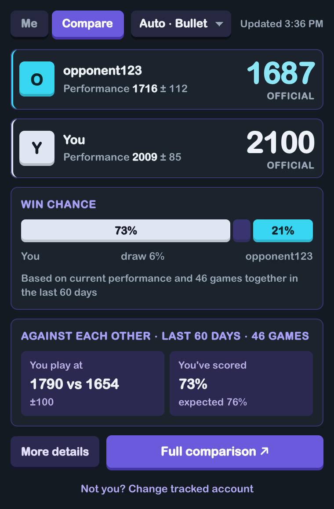
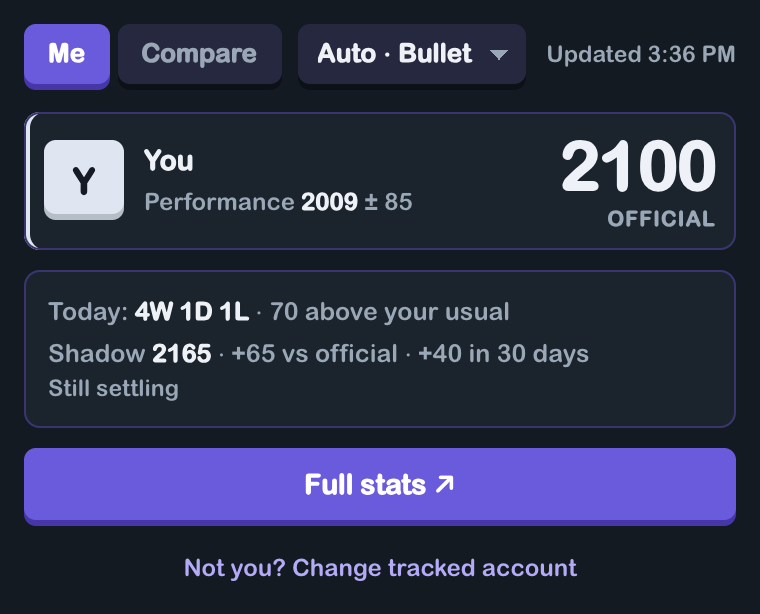
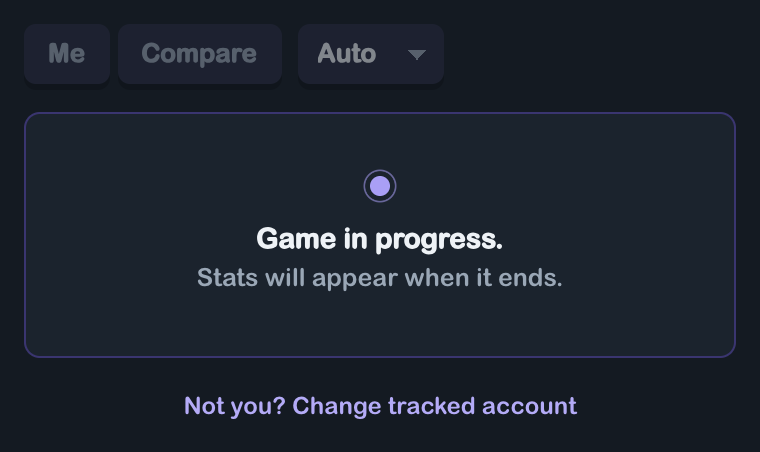

# DualChess

A Chrome extension that tells you how good you (and the person you're playing) actually are on chess.com right now, not just what the rating says.

## Why I made this

Honestly, chess.com's compare tab always felt kind of lacking to me. You get two ratings next to each other and a win count, and that's about it. I wanted to actually compare more about each person not just who has the bigger number.

I also play a lot with the same few friends(upto hundreds of games each), and I wanted to really look into those matchups. Who's been getting better, who plays above their rating against who, how it's gone month by month. I was always shocked when people would play so well against me but then i watch their games and they play worse. 

There's also my own performance. I play a lot of bullet but like 80% of my games are unrated. So my official rating barely moves and doesn't really say much about how I'm playing lately. Same problem the other way: someone's sitting at 1700 but they've been playing way better (or worse) than that for weeks.

So this looks at the actual games and works out a performance rating from recent results, how much to trust it, your chances of winning against someone, and a bunch of deeper comparisons for the people you play the most. Mostly I built it for myself, and it turned into a pretty fun project.

## What it does

Click the extension on a chess.com game or profile and you get two views:

- **Me**: your current performance level, and your official rating next to it, and a "shadow rating" (what your rating would be if your unrated games counted) which is for me. More is coming here soon: the plan is for this tab to be a dashboard for your overall play.
- **Compare**: you vs whoever's on the page. Official and current performance for both of you, how you do against each other if you've played 5+ games, and a win / draw / loss chance.

<p>
  
  
  
</p>

Left: Compare against someone you've barely played. Middle: someone you've played a lot (5+ games in the last 60 days), which adds the **Against each other** card and lets the head-to-head count towards the win chance. Right: Me. The numbers and the opponent in these are sample data.

There's also a **Full comparison** tab with everything else. This whole comparison feature is still being developed, so expect it to change and some parts to be rough or unfinished. So far it has:

- a race chart (who got to 1500, 2000, etc. first, in days and games). This one is a work in progress
- volatility (how streaky someone is)
- a climb breakdown, 100 points at a time
- the shadow rating over 30 days, 90 days, 1 year and all time
- head-to-head month by month
- a page explaining how every number is calculated

If you're spectating someone else's game it compares the two of them instead. I find it intersting to see how it would compare between the two. 

## Fair play

chess.com doesn't allow anything that helps you during a game, so this is strict about it:

- it never reads the board, the moves, or the clocks. Only usernames and the game ID.
- while a game is going on it shows nothing, just "Game in progress. Stats will appear when it ends."
- a game only counts as over once it's in the player's archive. If it can't tell, it stays locked.
- the Full comparison tab locks too if any chess.com tab has a game going.

<p>
  
</p>

## Install

It's not on the Chrome Web Store, so you load it yourself:


1. Download or clone this repo
2. Go to `chrome://extensions`
3. Turn on Developer mode (top right)
4. Click **Load unpacked** and pick this folder
5. Open a chess.com game or profile and click the extension. The first time, it asks which username is yours.

## How it gets the data

Everything comes from chess.com's public API, so no login and no scraping game data. The last 60 days of games get saved locally in Chrome so opening the popup again is instant, and after that it mostly just asks chess.com "anything new?" and moves on. Anything older than 60 days gets cleared out, so it stays small (a few hundred KB for a heavy player).

The stuff that needs every game you've ever played (the race, the climb breakdown, all-time head-to-head) only loads when you click **Load all games** on the Full comparison tab. Full histories can be big (some people have 20+ MB of games), so it asks before downloading one, and it's only kept while that tab is open.
I will be working on methods to reduce loading times. 

## Permissions and privacy

It asks for as little as it can:

- **activeTab** and **scripting**: to read the usernames (and the game ID) off the chess.com page you're on when you click it. Nothing else on the page.
- **storage**: to keep your username, your settings, and the last 60 days of games in Chrome on your computer.
- **chess.com and api.chess.com**: the only sites it talks to. It only reads public data, the same stuff anyone can see on a profile.

Nothing gets sent anywhere else. No account, no login, no analytics, no server of mine.

## Some of the math, quickly

- **Performance** is the rating that would make your expected score match your actual score over your last 20 games, using everyone's rating from *before* each game (chess.com saves the after one).
- **Confidence** drops the fewer games there are and the longer it's been since you played. This is shown through the variation of play such as ± rating on performance. It becomes more accurate as more games are played. 
- **Win chance** starts from the expected score, then splits the draws out using how often each of you has drawn in that time control over the last 60 days (against everyone, not just each other). If you've played each other a lot, the head-to-head counts for more. Some people have a sort of Magnus Effect against others. 
- **Shadow rating** replays your unrated games as if they were rated, starting from your last real rating. Honest result: it doesn't predict my rated games better than my official rating does, and the card says so. Mainly for me since i would have to play on alt accounts so my main rating isn't severly affected on bad days. 

The Full comparison tab has the long version of all of this.

## Built with

Plain JavaScript, HTML and CSS. No framework and no build step. The chart is [Apache ECharts](https://echarts.apache.org/), saved locally in `lib/` because Manifest V3 doesn't allow loading scripts from a CDN.

```
popup/      the popup (Me and Compare)
compare/    the full comparison tab
scripts/    the actual logic: performance, race, rivalry, data, fair play
lib/        echarts
```

All the math is in pure functions with no Chrome stuff in them, so it's tested with Node:

```
node --test scripts/*.test.js
```

## Stuff I know about

- There are some bugs with displaying data when there's no current game on the page.
- The More details tab has some issues displaying data too, so for now it just says "Coming soon".
- The race chart is still a work in progress.
- The shadow rating needs a rated game in the last 60 days to start from. If all your recent games are unrated (like mine) it stays blank until you click **Load all games**.
- In the "which username is you" box, clicking Save while it's empty makes the button stop working until you reopen the popup.
- When spectating it only compares the first two names it finds on the page.
- The race chart is too wide for the popup, so it lives in the Full comparison tab.
- chess.com sometimes fails to send a month of games. It'll tell you when that happens.

Made for fun and for my own bullet addiction. Not affiliated with chess.com.
